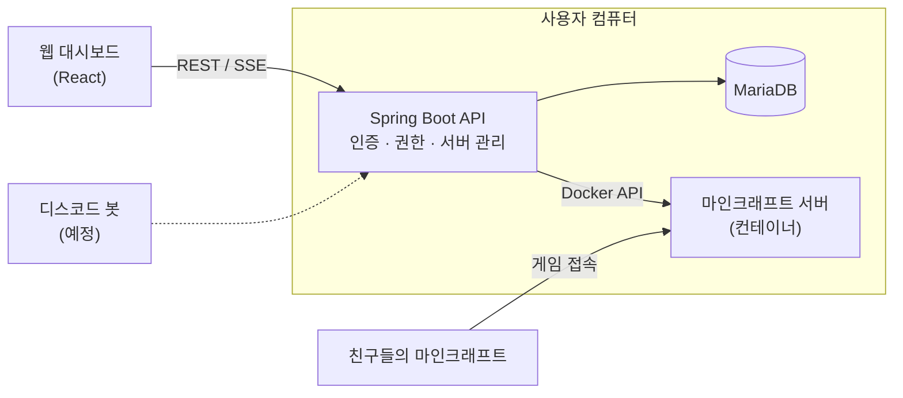

<div align="center">

# ServerDock

**친구끼리 쓰는 마인크래프트 서버를 웹에서 만들고, 켜고, 관리하는 셀프호스팅 도구**


</div>

> 개발 중이다. 웹 대시보드에서 서버를 만들고, 켜고 끄고, 실시간 콘솔로 명령어를 보내고, 친구를 초대하는 것까지 동작한다. 디스코드 봇과 월드 백업이 다음 단계다.

## 목차

- [왜 만들었나](#왜-만들었나)
- [기능](#기능)
- [구조](#구조)
- [권한 규칙](#권한-규칙)
- [시작하기](#시작하기)
- [API 문서](#api-문서)
- [프로젝트 구조](#프로젝트-구조)
- [로드맵](#로드맵)

## 왜 만들었나

- 모드 서버를 열려면 로더, 모드팩, Java 버전을 일일이 맞춰야 한다.
- 서버가 한 사람의 컴퓨터에 묶여 있어서, 주인이 없으면 친구들이 서버를 켤 수 없다.
- 서버가 켜져 있는지, 누가 접속 중인지 보려면 터미널을 열어야 한다.

ServerDock은 이걸 웹 대시보드와 디스코드 명령 하나로 해결하는 것을 목표로 한다.

## 기능

| 기능 | 상태 |
| --- | :---: |
| 회원가입, 로그인 (JWT) | ✅ |
| 서버 생성, 설정 변경 | ✅ |
| 서버 삭제 (2일간 휴지통 보관 후 완전 삭제) | ✅ |
| 서버별 역할 (OWNER / ADMIN / MEMBER) | ✅ |
| 초대 링크 (만료 시간, 사용 횟수 제한) | ✅ |
| 멤버 관리 (역할 변경, 내보내기, 나가기) | ✅ |
| Docker로 마인크래프트 서버 시작, 중지, 재시작, 상태 확인 | ✅ |
| 설정이 바뀌면 재시작 때 컨테이너 다시 만들기 (월드 유지) | ✅ |
| 자동 재시작 (서버가 죽거나 컴퓨터를 다시 켰을 때) | ✅ |
| 포트 충돌 감지 (다른 프로그램이 쓰는 포트면 켜지 않음) | ✅ |
| 실시간 콘솔 (로그 스트리밍, 명령어) | ✅ |
| 웹 대시보드 (서버 관리, 콘솔, 멤버, 초대, 휴지통) | ✅ |
| 디스코드 봇 (서버 켜기, 상태 알림) | 🛠️ |
| 월드 자동 백업과 복원 | 🛠️ |

✅ 완료 · 🛠️ 예정

## 구조

모든 구성 요소가 사용자 컴퓨터 한 대에서 돈다. 점선은 아직 만들지 않은 부분이다.



요청은 토큰 검사(401) → 입력값 검사(400) → 서버별 권한 검사(404/403) → DB 제약(409) 순서로 걸러지고, 모든 오류는 같은 형식(`ProblemDetail`)으로 응답한다.

## 권한 규칙

서버를 만들 수 있는 사람은 시스템 관리자뿐이고, 서버 안에서는 역할별로 할 수 있는 일이 나뉜다.

| 작업 | OWNER | ADMIN | MEMBER | 외부인 |
| --- | :---: | :---: | :---: | :---: |
| 서버 보기, 멤버 목록 보기 | ✅ | ✅ | ✅ | ❌ |
| 서버 켜기, 상태 보기 | ✅ | ✅ | ✅ | ❌ |
| 서버 끄기, 재시작 | ✅ | ✅ | ❌ | ❌ |
| 서버 설정 변경, 삭제, 휴지통에서 복구 | ✅ | ❌ | ❌ | ❌ |
| MEMBER 초대 | ✅ | ✅ | ❌ | ❌ |
| ADMIN 초대, 역할 변경 | ✅ | ❌ | ❌ | ❌ |
| 다른 멤버 내보내기 | ADMIN, MEMBER | MEMBER | ❌ | ❌ |
| 스스로 나가기 | ❌ | ✅ | ✅ | - |

휴지통에 있는 서버는 OWNER의 휴지통 목록에만 보이고, 다른 API에서는 없는 서버처럼 404로 응답한다. 보관 기간 동안 서버 이름과 포트는 그대로 잡혀 있다.

외부인에게는 403이 아니라 404로 응답해서 서버가 있다는 사실 자체를 숨긴다.

## 시작하기

**필요한 것**: JDK 25, Node.js, Docker (macOS는 [OrbStack](https://orbstack.dev) 권장)

```bash
# 백엔드 (http://localhost:8080)
cd backend && ./gradlew bootRun

# 웹 대시보드 (http://localhost:5173), 다른 터미널에서
cd frontend && npm install && npm run dev
```

DB(MariaDB) 컨테이너는 백엔드가 시작할 때 `deploy/compose.dev.yaml`로 알아서 띄운다(Spring Boot Docker Compose 연동). Docker만 켜져 있으면 된다. 백엔드를 꺼도 DB는 계속 켜져 있다.

개발용 관리자 계정은 백엔드가 시작할 때 자동으로 만들어진다: `admin` / `admin`

DB를 초기화하려면 `docker compose -f deploy/compose.dev.yaml down -v`로 지운 뒤 다시 띄우고, 백엔드를 재시작한다. 테이블은 백엔드가 시작할 때 Flyway가 만든다.

## API 문서

백엔드 실행 후 http://localhost:8080/swagger-ui.html 에서 모든 API를 보고 바로 호출할 수 있다.

1. `POST /api/auth/login`을 **Try it out**으로 보내 로그인한다.
2. 응답의 `accessToken`을 오른쪽 위 **Authorize**에 넣는다. `Bearer `는 붙이지 않는다.
3. 나머지 API를 **Try it out**으로 호출한다.

## 프로젝트 구조

```
serverdock/
├── backend/    Spring Boot API
├── frontend/   React 웹 대시보드
├── deploy/     Docker Compose 설정
└── docs/       문서
```

| 패키지 | 역할 |
| --- | --- |
| `common` | 보안 설정, JWT, 공통 예외 처리 |
| `user` | 계정, 로그인, 관리자 자동 생성 |
| `server` | 서버 설정, 멤버와 역할, 서버별 권한 검사, 전원 제어, 휴지통 |
| `invite` | 초대 링크 생성, 폐기, 수락 |
| `docker` | 마인크래프트 컨테이너 생성, 시작/중지, 상태 확인, 삭제 |
| `backup`, `discord` | 다음 단계에서 구현 |

## 로드맵

- [x] 계정, 로그인, 시스템 관리자
- [x] 서버 생성과 설정, 서버별 권한
- [x] 초대 링크와 멤버 관리
- [x] Docker로 마인크래프트 서버 실행, 시작/중지/재시작
- [x] 서버 삭제 시 2일간 휴지통 보관
- [x] 실시간 콘솔 (로그 스트리밍, 명령어)
- [x] 웹 대시보드 (React)
- [ ] 디스코드 봇, 월드 자동 백업
- [ ] `docker compose` 한 번으로 설치
